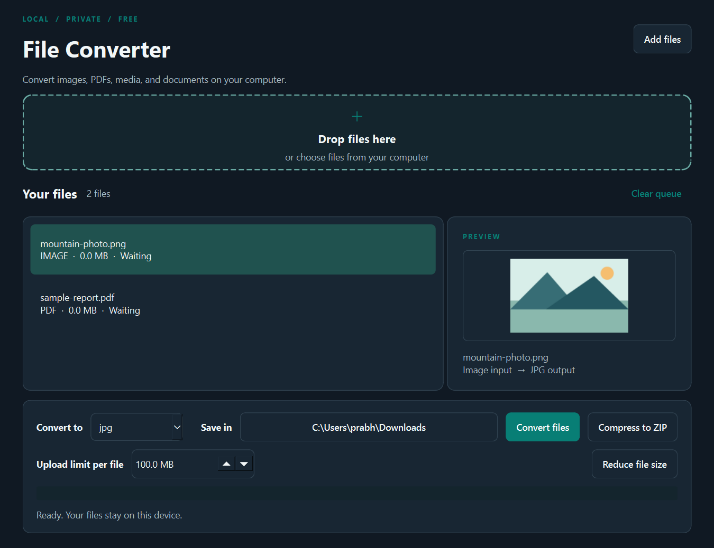
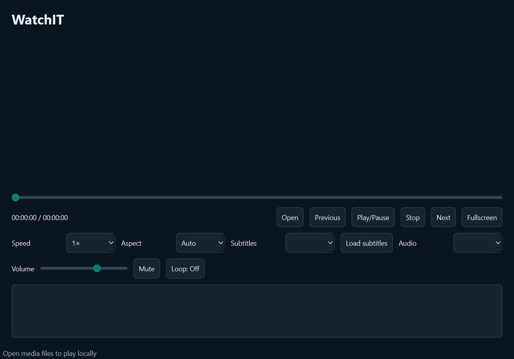

# FreeConvert

A free, local desktop converter and creative suite for Windows and macOS. Convert files, work with PDFs, images, media, ZIPs and OCR, or create documents, tables, presentations, formulas, drawings, databases, screenplays, and play media with WatchIT.



## Download

Download the zip for your system from the [latest release](https://github.com/Thatweirdguy1/FreeConvert/releases/latest). Extract it, then open `LocalFileConverter.exe` on Windows or `LocalFileConverter.app` on macOS. The macOS builds are unsigned; your system may require **Open Anyway** in Privacy & Security after the first launch. The app is free and needs no account.

Office conversions run inside FreeConvert using included Python format libraries. LibreOffice is no longer bundled or required. These conversions handle basic text, tables, and slide text; use the original Office application for files whose layout, formulas, embedded objects, or metadata must remain exact.

OCR runs locally using bundled [RapidOCR](https://github.com/RapidAI/RapidOCR) and English recognition models. No separate OCR installation, account, or network connection is needed.

**WatchIT** uses a bundled [libVLC](https://www.videolan.org/vlc/libvlc.html) runtime and plugins in release downloads. You do not need to install VLC separately to play media. When running from source, install VLC Media Player locally so the Python binding can find libVLC. Playback support depends on the VLC build and its plugins; protected media and some discs or streams may require external permissions or hardware.

## What it converts

| Input | Output |
| --- | --- |
| JPG, PNG, HEIC, HEIF, TIFF, GIF, BMP, WebP, SVG, RAW (CR2/NEF/ARW), ICO | JPG, PNG, TIFF, GIF, BMP, WebP, ICO, PDF (where different from input) |
| PDF | PNG, JPG, WebP (one image per page), TXT or DOCX (selectable text only) |
| MP4, MOV, AVI, MPEG/MPG, MKV, WebM | MP4, MOV, AVI, MPEG, MKV, WebM, GIF, MP3, WAV, M4A, AAC, FLAC, OGG |
| MP3, WAV, AIFF, M4A, AAC, FLAC, OGG | MP3, WAV, AIFF, M4A, AAC, FLAC, OGG |
| TXT, DOCX, ODT, RTF | The other document formats and PDF (basic content) |
| CSV, XLSX, ODS | The other spreadsheet formats and PDF (first sheet) |
| PPTX, ODP | The other presentation format and PDF (slide text) |
| CSV | TXT (plain CSV copy) |

Legacy binary DOC, XLS, and PPT are not supported by the native engine. Convert them to DOCX, XLSX, or PPTX in their original application first.

## Use

### Creative workspaces

The workspace bar opens these built-in, offline tools:

| Workspace | Create and edit | Local formats |
| --- | --- | --- |
| **Pages** | Rich text, bold, italic, underline, bullets, word count | DOCX, HTML, TXT; PDF export |
| **Tables** | Editable spreadsheet grid | XLSX, CSV |
| **Dazzle** | Slide titles and body text, add/delete slides | PPTX, Dazzle project; PDF export |
| **Formulaic** | Local equation source and preview: fractions, roots, scripts, Greek names | Formulaic source, MathML, OpenDocument Formula; PDF and PNG export |
| **Sketch** | Freehand pen, color, eraser | PNG, JPEG, BMP |
| **Organize** | SQLite tables and records; CSV import/export | SQLite, CSV |
| **Writer's Drafts** | Screenplay writing and preview | Fountain, FDX, PDF, TXT, HTML, Markdown |
| **WatchIT** | Video and audio playback with a playlist, seeking, speed, volume, mute, loop, fullscreen, aspect ratio, audio and subtitle track choices, external subtitles, sync offsets, and audio output selection | Local files supported by the bundled VLC build |

The office workspaces are focused editors, not copies of Microsoft Office or LibreOffice. Pages, Tables, and Dazzle copy unchanged imported DOCX, XLSX, and PPTX files byte-for-byte when saved to a new file. Pages edits text in existing paragraphs while retaining unchanged runs and their formatting; complex fields and structural edits can still be refused. Tables edits the active XLSX worksheet without rewriting other package parts, preserving other sheets, charts, metadata, and unsupported extension parts on a cell edit. It does not calculate formulas. Dazzle edits existing text boxes while retaining run formatting and nontext shapes; changes that alter text box paragraph structure are refused. Structural slide edits in complex imported decks are refused. These editors do not expose every advanced Office feature, and visual layout still needs checking in a full Office viewer. Formulaic offers a small formula language with `over`, `sqrt`, `^`, `_`, and common Greek names; it is not a full StarMath parser. It opens supported MathML and OpenDocument Formula files and refuses elements it cannot edit. Organize can browse external SQLite databases read-only; it edits databases created by Organize. Back up important originals before importing them.

### WatchIT



Select **WatchIT** from the workspace bar, then **Open** one or more local media files. Double-click a playlist item to play it. Use the timeline to seek, choose a playback speed from 0.25× to 4×, set the display aspect ratio, pick embedded subtitle and audio tracks, or load an external subtitle file. Audio and subtitle sync controls adjust timing in milliseconds; the output selector lists audio devices exposed by the current VLC module. Some devices may not enumerate or work. The player also has volume, mute, loop, previous/next, and fullscreen controls. **Space** pauses or resumes, **Left/Right** skips 10 seconds, **F** toggles fullscreen, and **Ctrl+O** opens files. Media stays local.

The bundled VLC build supports the formats its installed decoding and demux plugins provide, including common MP4, MKV, MOV, AVI, WebM, MP3, AAC, FLAC, and OGG media. No player can guarantee every file with one of these extensions will decode: codec variations, corruption, DRM, and platform decoders affect playback. WatchIT is a player; the separate conversion tools still use FFmpeg and have their own format list above.

### Writer's Drafts

Select **Writer's Drafts** in the main window to write a screenplay locally. The editor uses [Fountain](https://fountain.io/syntax/) as its editable source format, with a live formatted preview, title page fields, scene navigation, a beat map (`#` sections and `=` synopses), character picker, emphasis buttons, dual dialogue, find, and local autosave with crash recovery. **New**, **Open**, and **Save** work with `.fountain`; **Open** also imports Final Draft `.fdx`, plain text, and Markdown. Scripts stay on your device.

Use **Export** to save a separate **PDF, Fountain, Final Draft (.fdx), plain text, HTML, or Markdown** file. Existing export files are not overwritten. PDF uses US Letter screenplay pages by default; HTML is printable in a browser. An unchanged FDX import exports byte-for-byte. For text edits that map safely to the same paragraphs, FDX export retains other XML nodes, attributes, and scene metadata. When paragraphs are added, removed, retyped, or contain multiple styled text runs that were edited, the app asks before producing a new FDX that may lose unsupported metadata. It will not silently claim a lossless round trip.

PDF export from an imported FDX uses supported page size, top/bottom margins, element indents, font size, line spacing, space before, alignment, and start-new-page settings. It keeps scene headings with their following action and character cues with their first dialogue line when they fit. Very long dual dialogue is laid out sequentially to avoid clipping. This is the app's own deterministic layout, not Final Draft's renderer, so matching Final Draft page breaks is not guaranteed. For an exact Final Draft layout, export a PDF from Final Draft and use that PDF as the final copy.

Select an element in the toolbar or press **Ctrl+1–8**. **Tab** and **Shift+Tab** move through element types. Use **Ctrl+B/I/U** for emphasis, **Ctrl+D** to mark a second character cue as dual dialogue, **Ctrl+K** to insert a known character, and **Ctrl+S** to save. **Forward writing** provides optional timed sessions that lock completed lines while the timer runs. The writing tools work offline and need no account.

### File conversion

1. Drag files into the window or select **Add files**.
2. Select each file for a visual image/PDF preview and choose its output format. Mixed formats can share one batch.
3. Choose a save folder and select **Convert files**.

For a shortcut, hold **Shift** while dropping files into the app's drop area. A menu at the pointer shows formats shared by those files and anything already queued. Choose one to apply that format to the queue and start conversion immediately into the selected save folder; dismiss the menu to cancel. The shortcut works inside the app window on Windows and macOS.

**PDF tools** merge queued PDFs in queue order, or split, reorder, and rotate the selected PDF. **Image tools** resize to fit within a width and height, crop by coordinates, rotate, or remove metadata from the selected image. Each tool saves a new file in the chosen folder. Animated images must be converted to a still image before editing.

**Media trim** takes start and end times in seconds. Precise trim re-encodes for accurate cuts; fast trim copies streams and may start at a nearby keyframe. It saves a new file alongside other outputs. FFmpeg is bundled with the app.

**Open ZIP** previews the selected archive's entries and unpacked size, then extracts it to a new numbered folder. Extraction rejects unsafe paths, duplicate names, symlinks, encrypted entries, and archives over 10,000 entries or 2 GB unpacked. Very high compression ratios are also rejected. **OCR to text** reads the selected image or each page of a scanned PDF and saves a UTF-8 text file. Recognition quality depends on the scan.

For command-line OCR, run `LocalFileConverter.exe --ocr input.png output.txt` on Windows or `LocalFileConverter.app/Contents/MacOS/LocalFileConverter --ocr input.png output.txt` on macOS. Existing output files are not replaced.

Select **Compress to ZIP** to save the queued files in one lossless archive. Files with duplicate names cannot share an archive.

For upload limits, enter a per-file size in MB and select **Reduce file size**. This creates WebP images, MP4 videos, MP3 audio, or a smaller PDF. The app checks the completed output and reports a failure if it cannot meet the limit. This mode may reduce image quality or dimensions; PDFs are rasterized, so their text will no longer be selectable. Animated images and Office documents are excluded from this mode.

Inputs are never overwritten. Existing output names and collisions within a batch get numbered copies, such as `photo (2).webp`. Multi-page PDF image outputs reserve all page names before the batch starts. Conversion and tools run in the background so the interface stays responsive; each item reports its stage and result.

## Run from source

Python 3.11+ is required.

```bash
python -m venv .venv
# Windows: .venv\Scripts\activate
# macOS: source .venv/bin/activate
python -m pip install -r requirements.txt
python app.py
```

Run the conversion checks with `python -m unittest -q`. If you have local Office test files in `test docs`, run `python verify_office_fixtures.py` to check one text edit per DOCX, XLSX, and PPTX against copies. Tagged commits build Windows x64, macOS Intel, and macOS Apple Silicon downloads through GitHub Actions.

## Privacy and security

Files stay on your computer. The app has no upload service, analytics, or account. External media tools are launched without a shell, inputs are not replaced, and SVG links to external resources are rejected. It is **not an operating-system sandbox**: format libraries and codecs process supplied files with your user permissions. Only convert files from sources you trust. The bundled macOS app is not notarized.

## Limitations

- Regular PDF to text extracts embedded/selectable text. Use **OCR to text** for scanned PDFs.
- PDF to DOCX uses extracted text and does not preserve the PDF layout, images, or tables.
- Animated GIF input becomes a multi-page PDF or an animated GIF. Other raster outputs use the first frame.
- CSV to XLSX stores values as text; XLSX to CSV exports the active worksheet's displayed values.
- Cross-format Office conversion still handles basic content. It refuses many advanced DOCX, XLSX, and PPTX files when it detects content it would discard, such as media, charts, formulas, or extra worksheets. Detection is not exhaustive; styling, metadata, or other unsupported parts may still change. The loss-minimizing edits in Pages, Tables, and Dazzle apply when saving back to the same Office format. TXT and CSV are deliberate text/value extraction. PDF output is a simple rendering of extracted content, not an exact printout. Check important documents after conversion.
- Large scripts can be opened without a fixed size cutoff, but opening and rendering very large scripts may require substantial memory and may feel slow.
- The native engine does not parse Final Draft metadata or reproduce Final Draft's pagination.
- Bundled OCR currently recognizes English text. RapidOCR and its converted PaddleOCR models are distributed under Apache 2.0; see [third-party notices](THIRD_PARTY_NOTICES.md).
- macOS builds are unnotarized and Windows builds are unsigned.

MIT licensed. See [LICENSE](LICENSE).
