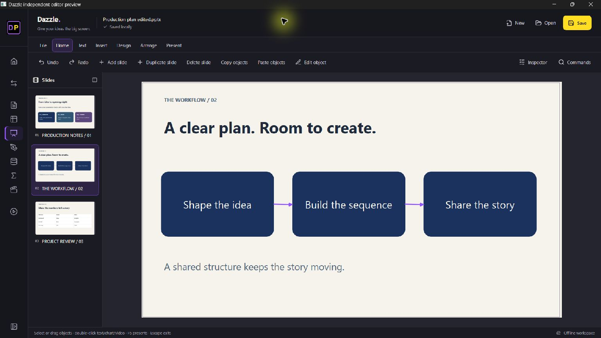
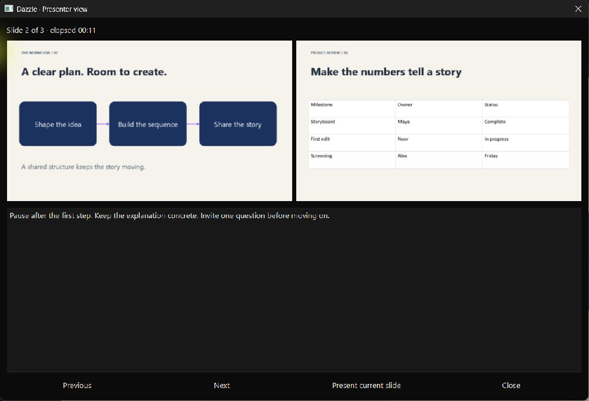

# Dazzle 0.31: independent presentation editing

Dazzle edits local PPTX and Dazzle projects using python-pptx and Qt. Office, an account and a connection are not required. React/Tailwind/Lucide controls use the real native document model.

## Authoring controls

| Area | Features |
| --- | --- |
| Files | New/Open, Save as PPTX/Dazzle, PDF, new PNG slide batches |
| Slides | Add/delete/duplicate, move up/down, layout, slide size, backgrounds, hide/show, notes, templates |
| Text | Font/size, bold/italic/underline, color, paragraph alignment, bullets/numbering; Format text edits selected runs in a rich text dialog |
| Insert | Text, six shapes, pictures, tables, column/bar/line/pie/scatter charts with editable data, embedded video, connectors, validated web/mail hyperlinks |
| Arrange | Multi-selection, cut/copy/paste, duplicate/delete, group/ungroup, align/distribute, flip, numeric position/size/rotation, front/back |
| Pictures | Percentage crop on each edge, flip, resize, rotate |
| Present | Current/beginning, next/previous, Home/End, blackout, fade transition, fade-on-click builds, notes, current/next presenter previews and elapsed clock |

Shift-click or drag a rectangle for multi-selection. Ctrl+A/C/X/V selects/copies/cuts/pastes objects; Ctrl+D duplicates; Ctrl+G and Ctrl+Shift+G group/ungroup; F2 edits an object, Ctrl+E formats text, Ctrl+K adds a link. Arrows nudge by one point, Shift+arrows by ten. F5 presents from the beginning, Shift+F5 from the current slide; Escape exits, B toggles blackout. Extra commands remain searchable in Commands; Inspector exposes native properties.

The private clipboard works within the Dazzle window, including across slides. Copied charts/diagrams have independent data. Slide duplication retains its layout/master. Undo/redo stores native snapshots. Imported PPTX originals initially require Save as a new file. Previews do not write package XML; PNG export creates a fresh directory. Notes remain separate from slides and PDFs.

## General rendering

The shared canvas resolves themes, inherited master/layout artwork, text styles/margins/anchors, explicit overflow/autofit scale, common fills/gradients, grouped transforms, image crops/flips, common preset/custom geometry and cached SmartArt geometry, connectors, text and icons. Existing diagram nodes can be edited with F2 while retaining topology. This reads OOXML drawing caches; it is not special-cased to a filename. Microsoft documents the [diagram cache relationship](https://learn.microsoft.com/en-us/openspecs/office_standards/ms-odrawxml/f26151ec-9197-4a20-96f3-2d104642cbe5).

## Compatibility limits

This is **not full PowerPoint feature parity**. Morph, arbitrary imported animation timelines, SmartArt layout generation/reflow, OLE/ActiveX, VBA, 3D models, recording/narration and full master editing are unsupported. Some shadows, geometry, advanced typography, font substitution, table themes, charts and complex spacing differ. Only the listed chart types have native editable previews. Rotated/flipped groups must have those transforms reset before ungrouping.

Presenter view is a notes/rehearsal window, not a synchronized dual-monitor PowerPoint Presenter View clone. Hidden slides are skipped in forward/back navigation, but may be explicitly presented from the current slide. PDF/PNG includes the entire deck, including hidden slides. Video is local; exports are static. Unsupported native XML is retained where python-pptx preserves it; retention is not rendering, playback or editing support. Review important imports and exports.

## Validation and inspection

Synthetic regression cases cover cached diagram rendering, inherited artwork, read-only package bytes, diagram edits, independent duplicates, grouping, clipboard, crop validation, connectors, links, layouts, hidden state and save/reopen. Packaged React/native checks also exercise grouping and text-size commands. README screenshots contain synthetic content.

A private eight-slide deck was compared locally with read-only PowerPoint PNG exports. Its previously missing SmartArt, icons, text and master/layout artwork now render. Differences remain in some effects and typography. Neither that document nor its reference images are distributed.

Requested REA inspection used Rizin and Ghidra 12.1.4 on PowerPoint 16.0.20527.20088. Executable SHA-256: `bd691968afb0fe206de6b64c78cf66f334adf011a866f5933301536ca7955c30`. Static analysis found 142 procedures and 97 strings; the small bootstrap imports `ppcore.dll`. This does not reconstruct Office's renderer or establish suite parity. Documented read-only PowerPoint export supplied local visual references only; no proprietary code was copied. JADX, Apktool and ADB target Android artifacts and were not applicable to this Windows executable.
