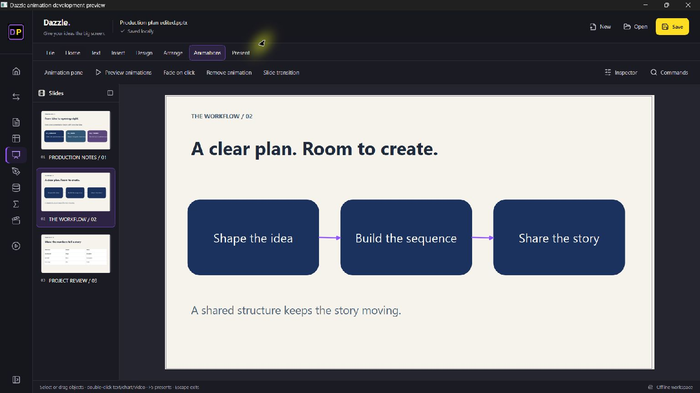
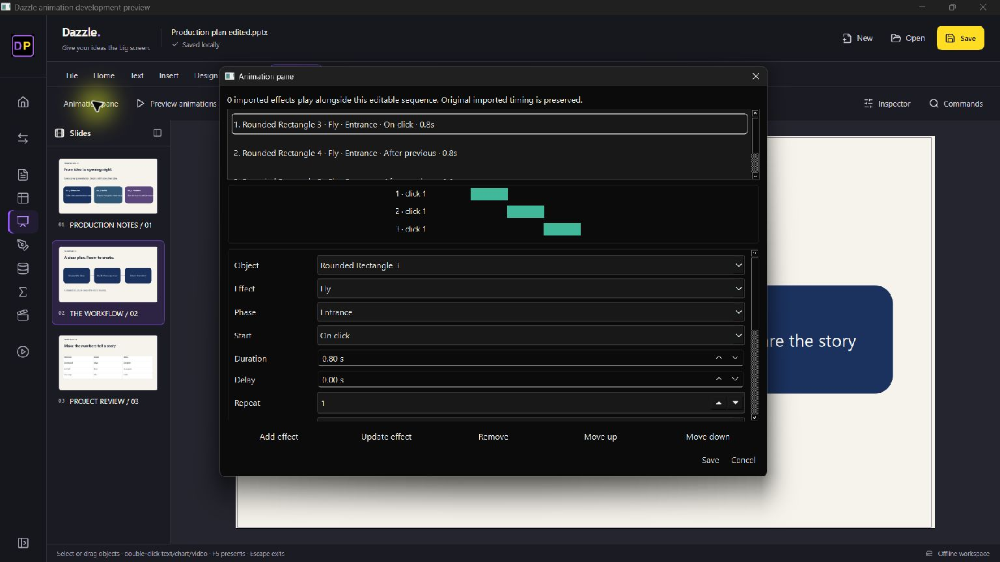

# Dazzle 0.32: animation and authoring update

Dazzle remains an independent, offline editor. This update adds real animation authoring and playback to the native presentation model, alongside more text, table, geometry, master and theme controls. It does not deliver complete PowerPoint parity.

## Working additions

- **Animations:** 25 named effects, entrance/emphasis/exit phases, multiple effects per object, click/with/after sequencing, duration, delay, repeats, object triggers, normalized motion paths, easing, auto-reverse and rewind. Simultaneous effect transforms compose. The animation pane edits Dazzle-authored effects; imported native timing is retained and supported effects play alongside them.
- **Transitions:** Fade, Push, Wipe and object-based Morph, with durations and timed slide advance. Morph matches object names; it is not character/word Morph. Blackout pauses running effects, transitions and the slide timer.
- **Text:** double-click text to edit on the slide; Ctrl+B/I/U formats the selection, Ctrl+Enter commits, Escape cancels. Paragraph/frame controls include margins, spacing, line spacing, tabs, columns, wrapping, vertical alignment and autofit.
- **Shapes:** 187 preset geometry definitions, including guide formulas and custom adjustments, feed the shared renderer and insertion library.
- **Tables:** double-click a table to edit its grid, add/delete rows and columns, merge/split cells, set fills, apply header/banded formatting and adjust dimensions. Structure changes require splitting existing merges first. Edits use a working copy until Save; Cancel does not alter the original.
- **Masters/themes:** edit master/layout object properties, placeholders, backgrounds and text; duplicate layouts; change theme colors/fonts and save/load local theme variants. These are property editors rather than a complete visual master canvas.

The existing light/dark slide design is retained. Unsupported imported XML is not replaced by decorative placeholders just to claim support. Save important imports as a new file and review exported results.

## Open-source reuse

Animation math and timing mappings adapt [DeckCraft](https://github.com/storytold/deckcraft) commit `0d45a64db23baa0a4c8f9f7ac14c59c91b40fec9`, under its MIT option. See [provenance](../assets/DECKCRAFT_SOURCE.md), [license](../assets/deckcraft-LICENSE-MIT.txt) and [notice](../assets/deckcraft-NOTICE.txt). No DeckCraft branding, UI or fonts are included. DeckCraft itself documents compatibility gaps; reuse does not establish parity.

Preset geometry comes from Apache POI under Apache 2.0; its pinned source, license and notice are [recorded separately](../assets/PRESET_GEOMETRY_SOURCE.md).

## Validation and limits

Regression checks exercise scene opacity/rotation/scaling, simultaneous effects, timing, blackout, native save/reopen, geometry, inline edit/undo/cancel, themes/layouts, and table structure/merges/cancel. The React/native suite checks the new action bindings and visible animation state. Read-only PowerPoint automation opened a synthetic exported PPTX and recognized all 25 native effects. This proves valid native effect entries, not pixel-identical playback.

The screenshots use synthetic content. The user's private deck and Office reference renders are not distributed.

Craft Anything independently inspected the installed PowerPoint bootstrap, SHA-256 `bd691968afb0fe206de6b64c78cf66f334adf011a866f5933301536ca7955c30`. Its static overview reports stripped symbols and unresolved indirect jumps (evidence `ev_a906669ab8cb7680d612502135cb4fc853246c574e9f10045474d81df470b226`). Static analysis cannot establish renderer or suite parity. No proprietary implementation is copied.

Still remaining: fully editable imported timelines and paragraph builds; complete effects catalog and exact masks; arbitrary triggers and indefinite repetition; full typography/shadows/WordArt fidelity; freeform/edit-points/boolean shape tools; SmartArt generation/reflow; complete table themes/chart types/axes; audio authoring, recording and video export; synchronized dual-monitor Presenter View and live ink; comprehensive spelling/review/accessibility workflows; legacy formats, VBA, ActiveX/OLE and Office add-ins. Object Morph is an approximation. Circle/diamond reveal masks currently use rectangular clips. Unknown native effects may preview as Fade while their XML remains preserved. Imported timing is not yet a fully editable timeline.
