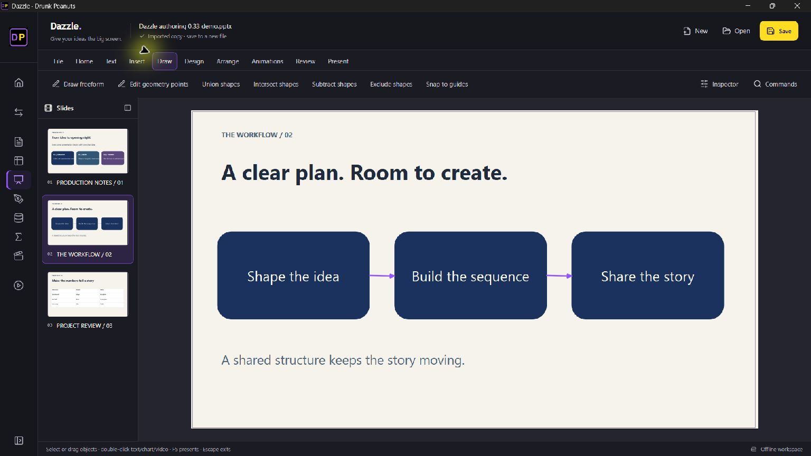
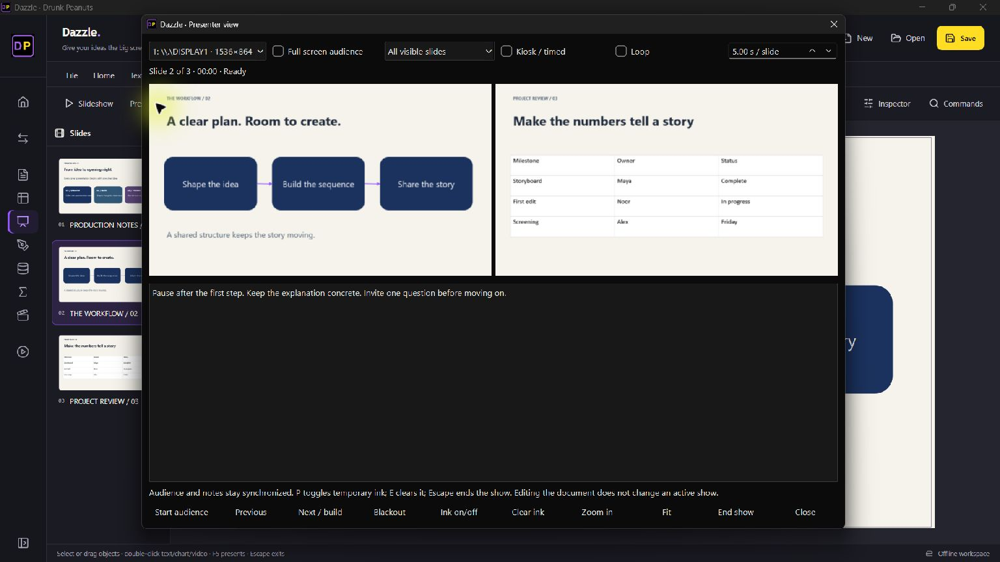

# Dazzle 0.33: imported timing, authoring and presenting

This release improves the independent editor across animations, drawing, tables, charts, review, printing and formats. It does **not** complete PowerPoint parity.

## New working controls

| Area | Added behavior |
| --- | --- |
| Imported animation | Edit native durations, delays, repeats, easing and auto-reverse. Timing-only changes retain imported effect graphs. Supported effects can be replaced and reordered. Unknown native effects retain their XML and are labeled by preset; they must be explicitly replaced before structural changes. Validation errors leave the pane open. |
| Playback | True circular/diamond reveal masks, indefinite repeats, ordered trigger batches and repeatable trigger sequences. A click finishes a running indefinite effect. |
| Drawing | Click vertices and press Enter/double-click to finish a freeform polygon; Escape cancels. Edit native geometry/control-point coordinates, Union/Intersect/Subtract/Exclude selected drawing shapes, and toggle drag snapping to slide/object edges and centers. Undo restores original geometry. |
| Tables | Insert/delete rows or columns through merged regions while retaining spans and merged content, including deletion of the original corner cell. The grid expands columns to use the dialog width. |
| Charts | Eleven types: column, bar, line, pie, scatter, stacked column/bar, area/stacked area, doughnut, and column + line. Edit titles, axis titles/bounds, legends and value labels; change types while keeping object identity and position. Combination charts use a shared primary axis. Native chart data remains editable in PPTX. |
| Review | Native alternative titles/descriptions; local legacy PPTX comments with editable author labels; object reading order with keyboard move controls; checks for missing slide titles/descriptions, small text and missing table headers. Reordering also changes stacking order. |
| Printing | Native print preview and PDF output for slides, paginated speaker notes and 2/3/4/6/9-slide handouts; optional inclusion of hidden slides. PDF output is written atomically. |
| Formats | Native PPTX, POTX templates and PPSX slideshows; optional ODP import/export and legacy PPT import through an installed LibreOffice. Imported originals require saving to a new file. Home routing and Windows Open With recognize these formats without changing defaults. |
| Presenting | A modeless Presenter View controls the actual audience window. Current/next previews and notes follow audience navigation. Monitor/fullscreen selection, custom show sequences, runtime timed/kiosk looping, blackout, zoom and temporary live ink are available. Active shows use a document snapshot. |

Presenter shortcuts: **P** toggles ink, **E** clears it, **B** toggles blackout and **Escape** ends the show. Ink is temporary and is cleared on slide navigation; it is not saved to the document. On a single monitor, use windowed audience playback. Custom show sequences are saved in native PPTX; runtime kiosk options are session settings.

## Interoperability and evidence

- A PowerPoint-authored fade was imported, edited and reopened read-only in PowerPoint: duration changed from 1.2 to 2.4 seconds and repeats from 3 to 4 while the 0.3-second delay remained intact.
- PowerPoint opened the synthetic custom geometry, merged table, local comment and custom show in PPTX, POTX and PPSX packages.
- PowerPoint recognized all eleven chart types, including a two-plot combination; scatter labels were recognized. LibreOffice rendered the eleven-slide chart deck to an eleven-page PDF and completed an ODP round trip.
- Regression checks cover native XML preservation, ordering, masks, indefinite playback, triggers, geometry/undo, merged-table edits, chart options/type changes, comment and format round trips, notes/handout PDFs, presenter navigation, kiosk order and snapshot isolation. The React/native suite checks action bindings and responsive layouts.
- All 115 Python tests and the React build passed; Windows, macOS Intel and Apple Silicon packaged checks passed in [release run 43089576763](https://github.com/Thatweirdguy1/Drunk-Peanuts/actions/runs/43089576763).
- Installed Windows 0.33.0 passed dashboard, Office/media/playlist, native conversion and multilingual OCR checks. Native UI verification confirmed imported circular playback, synchronized audience navigation and the on-screen windowed audience title bar. Earlier source checks exercised freeform drawing/undo and live ink. Screenshots show the installed app with synthetic content. This laptop exposes one monitor; physical dual-monitor operation remains unverified.

The user's original presentation and private reference images remain local and unmodified. Screenshots use synthetic content. Recognizing a native object or opening a package does not prove identical appearance in every engine.

Requested inspection reused REA/Ghidra's PowerPoint bootstrap evidence `ev_216b810d7b893088efc69325062f578f2f26ee1fec2822c4e94136d0ff8e7d55`; Rizin inspected LibreOffice's `sdlo.dll` without changing it (`ev_120edb5426518c31067433b1a1f2649187994b3af133e4feeac843d12ced8640`). Craft Anything's LibreOffice overview is partial: discovery stopped at 50,000 functions and has unresolved jumps (`ev_93259c11eee52c13a597d49526a4ec7dfe042a96c6e11ee026800e9b572b5f24`). These are static observations, not reconstructed rendering engines. No proprietary implementation is copied. Android-specific JADX/Apktool/ADB do not apply to these Windows binaries.

DeckCraft adaptations remain pinned and attributed in the [source notice](../assets/DECKCRAFT_SOURCE.md). Native QPainter rendering keeps the existing runtime dependency set.

## Remaining work

Pixel-exact typography/font substitution, shadows/effects and WordArt; a full visual master canvas; the complete animation/transition catalogs; per-paragraph playback and exact word/character Morph; arbitrary complex imported timing graphs; advanced freehand/curve handles and guides; SmartArt generation/reflow; complete table themes/borders and chart styling, secondary-axis/linked-data workflows; audio authoring, trimming, recording, narration and video export; persistent annotations and more presenter navigation; full spelling/threaded review/accessibility checks; VBA, ActiveX/OLE and Office add-ins remain incomplete or unsupported.

Paragraph targets are retained/exported, but Dazzle currently previews those effects on the whole object. Structurally rebuilding supported imported effects can simplify their original options; unchanged graphs and timing-only edits preserve native behavior. ODP/PPT conversion is an optional external-engine workflow and may change fidelity. The accessibility checks are a limited checklist, not a comprehensive assessment.
