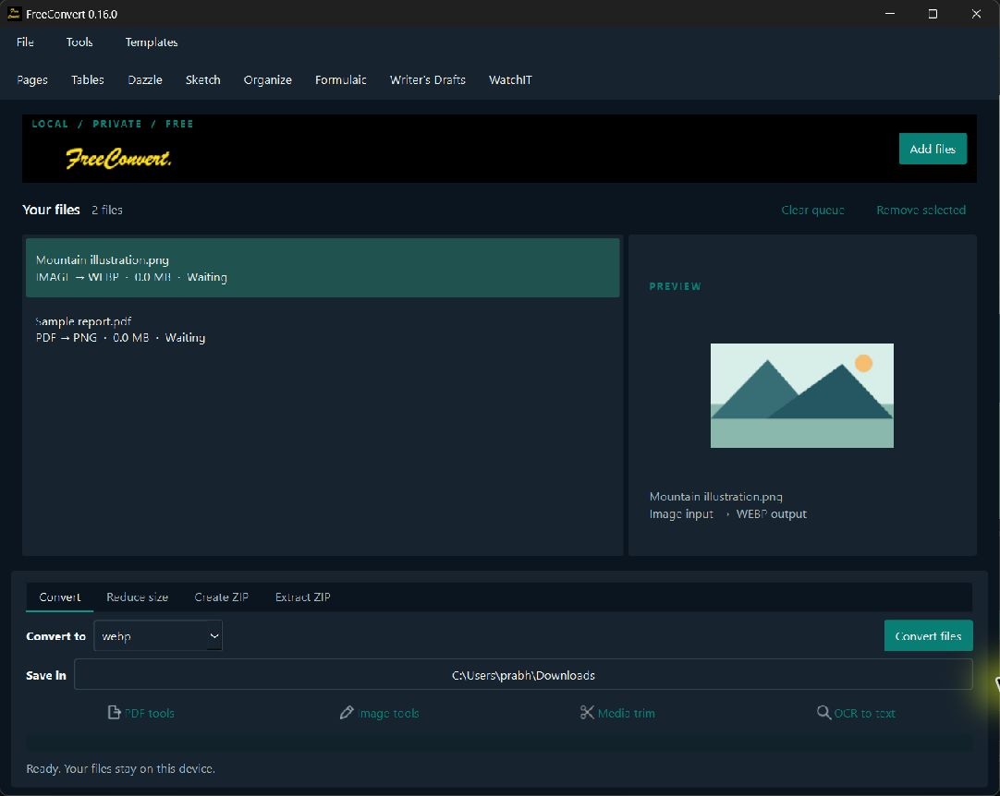
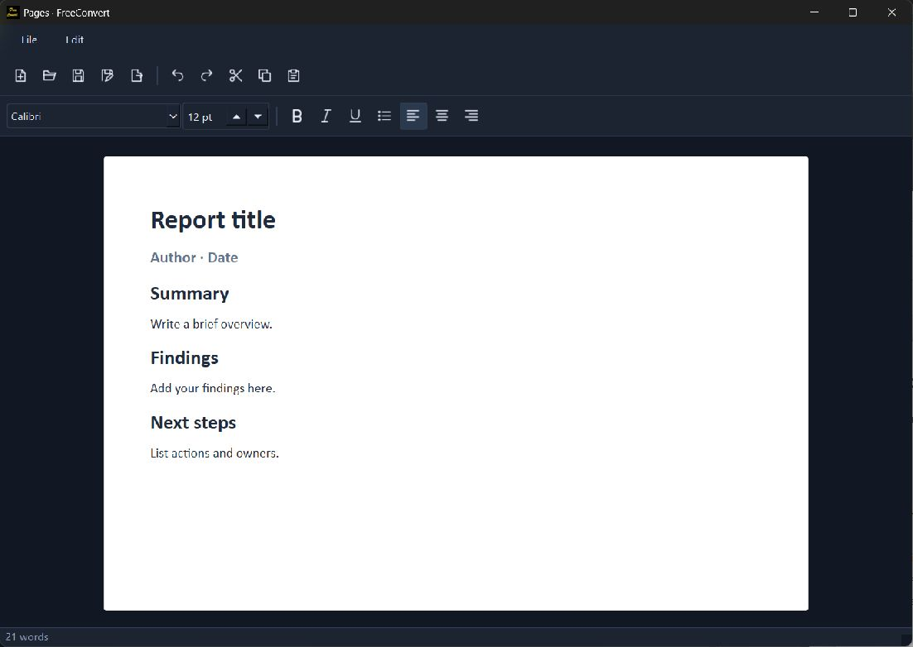

# FreeConvert 0.16.0

## Requested problems and changes

| Problem | Change |
| --- | --- |
| Large, blocky toolbars | 18px icons across Office, Writer's Drafts and WatchIT; WatchIT buttons reduced from 40px to 32px; slimmer padding, borders and controls. Text tooltips, menus and keyboard shortcuts remain. |
| Converter actions hard to find | Explicit Convert, Reduce size, Create ZIP and Extract ZIP task tabs, plus a Tools menu. Auxiliary PDF/image/trim/OCR actions use flat icon/text buttons. |
| Shift conversion unclear | Shift+Enter converts the queued files. Existing Shift-drop quick-format menu retained and mentioned in the Convert tooltip and drop area. |
| Generic identity | Original bold cursive yellow `FreeConvert.` wordmark on black, branded application/installer icon, Windows executable product/version metadata. |
| No desktop launch | Per-user Windows installer with Desktop and Start menu shortcuts, Installed apps/uninstaller entry, stable installation directory. No Python installation or terminal required by the user. |
| Missing media Open with entry | Registers WatchIT for supported media extensions. Quoted shell command opens the selected file and waits for the playback engine. Existing default player remains unchanged. |
| No document starters | Templates menu with 11 local editable starters; choosing one creates a new file and workspace. Originals and any existing unsaved editor are preserved; existing destinations cannot be overwritten. |

The [Superdesign draft](https://p.superdesign.dev/draft/38be1761-6349-4ebf-9492-3acad45785ba) was approved before applying the visual redesign. The implementation uses the existing native Qt widgets and shared original SVG icons, with no new UI dependency.

## Signing and analysis

See [Windows installation and signing](WINDOWS_INSTALL_AND_SIGNING.md) for certificate options, Windows registration details, native-app REA inspection and its limits. The app and installer are unsigned. Signing was not purchased or simulated.

The Office editors remain lightweight editors, with the existing import/export limitations documented in README. This change does not reconstruct Microsoft's document layout engine or claim Office feature parity.

## Verification

Source unit checks cover all four task modes, non-overlapping controls at three window sizes, queued media activation, template copying/no-overwrite behavior, preservation of an existing unsaved editor, existing conversion and Office regressions. Packaged checks and Desktop/Open with smoke-test evidence are recorded in `build/qa` during the local build.

The local Windows installer completed with exit code 0. Desktop shortcut target: `%LOCALAPPDATA%\Programs\FreeConvert\LocalFileConverter.exe`. `Get-StartApps` lists FreeConvert. The installed executable and tested staging executable hashes are compared after installation. Source suite: 57 tests passed; the added icon-size assertions also passed. Packaged native conversion, OCR, Office and WatchIT checks exited successfully. Embedded app/ui/watchit code objects are checked against the current source.

The Desktop shortcut was launched successfully. Windows `ShellExecuteEx` with the registered `FreeConvert.Media` class opened a synthetic MP4 in WatchIT; decoded video, fullscreen and Escape restoration were observed. An actual report was created through the installed Templates menu and opened in a separate Pages window. The first smoke test exposed a plain-text starter preview; bundled report/letter/notes HTML now supplies their typography, and a regression check verifies that 28pt report-title formatting survives DOCX save. The Explorer menu itself was not clicked during the user's active Explorer interaction; registration and the shell handler were verified independently.
