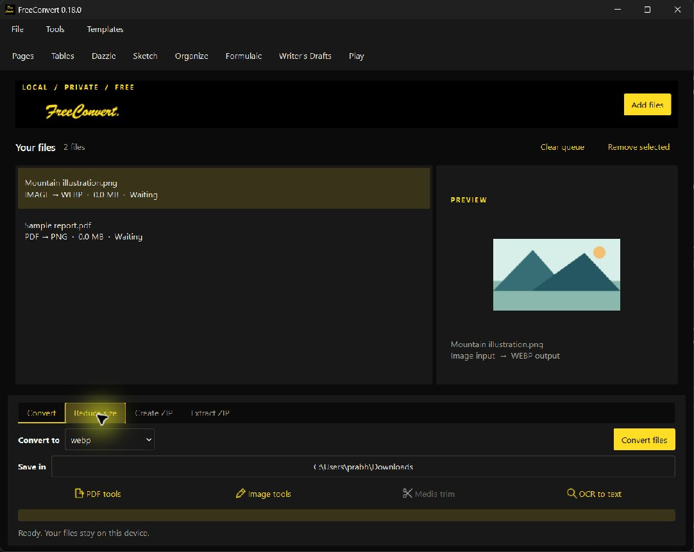
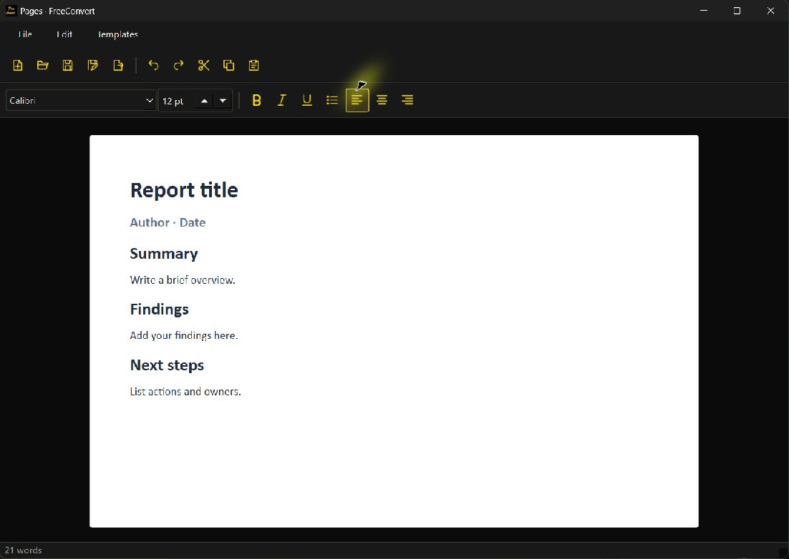
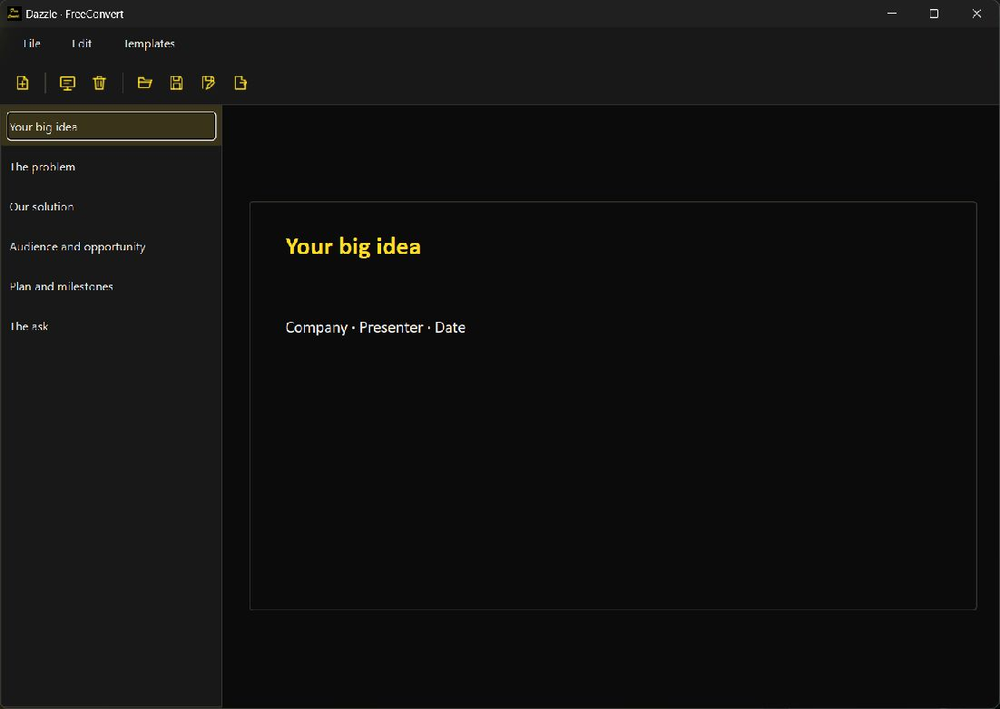
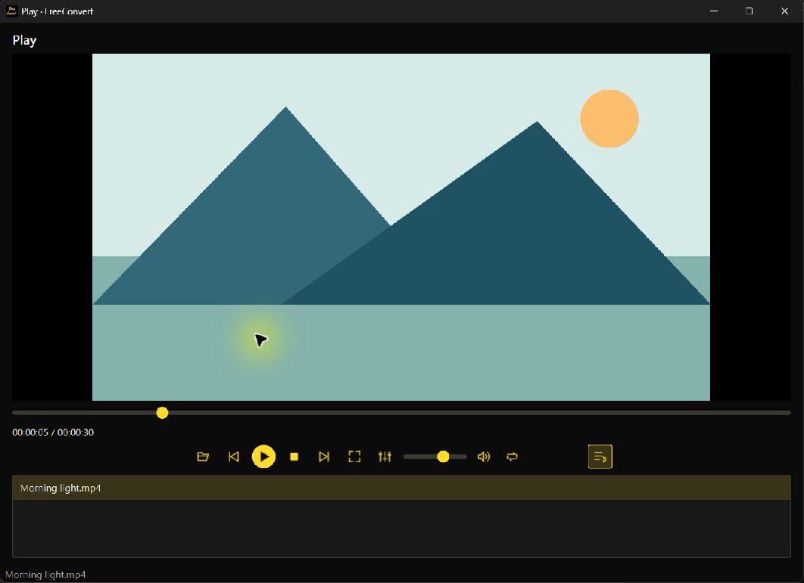

# FreeConvert 0.18.0 desktop verification

## Changes

The shared Qt hover handler covers push buttons, toolbar buttons, format dropdowns and individual task tabs. Each hovered tab gets its own highlight rectangle; moving between tabs resets the fade without selecting a different task. Pointer leave, disabled controls, hidden windows and window deactivation clear the overlay. The handler retains Qt-created button wrappers until destruction, preventing the stuck highlights seen in 0.17.0.

The media workspace is named Play. The application uses a consistent black/yellow theme with 18px icons, and the Office Suite has 15 original starter documents, including six Dazzle decks. Templates copy to new user-selected files and do not replace existing documents.

## Evidence

- Source suite: **62 tests passed**, including tab-to-tab pointer movement, unchanged task selection, disabled tabs, dropdown interaction, native toolbar wrapper lifetime, theme/template persistence and existing conversion/data-preservation checks.
- Windows 0.18.0 was installed and opened from its Desktop shortcut; the staged and installed executable SHA-256 hashes match. Live checks confirmed tab/dropdown hover appears and clears, Convert stays selected during tab hover, original templates open in Pages/Dazzle, and Play decodes the local demonstration clip.
- Windows packaging includes the bundled VLC runtime, OCR models and Office starters. Native conversion, Office/playback and OCR are checked separately against the packaged executable.
- Screenshots below are fresh Windows app captures with original synthetic demonstration files and bundled starter templates. No private user documents appear.
- Tagged GitHub Actions builds run source and packaged checks on Windows x64, macOS Intel and macOS Apple Silicon before creating the release draft. macOS UI is not manually exercised here.

## Current interface

Windows releases are unsigned and macOS releases are not notarized. See [installation and signing](WINDOWS_INSTALL_AND_SIGNING.md) for the distribution status. The existing [usability audit](USABILITY_AUDIT.md) records broader repairs and remaining editor limits.
