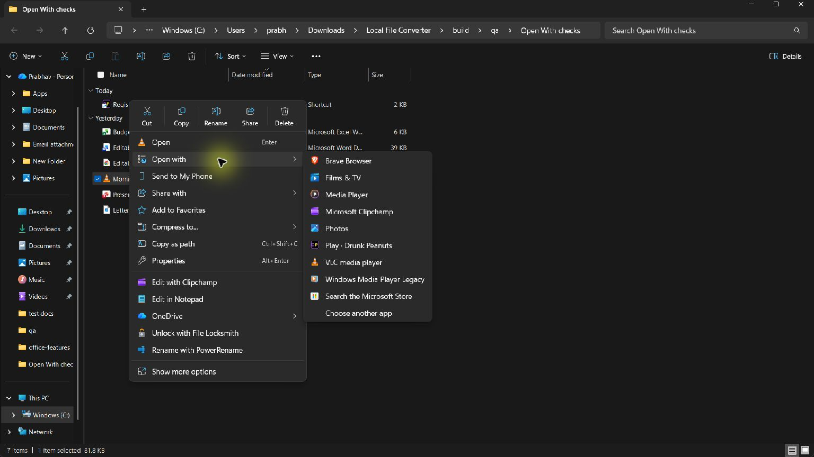
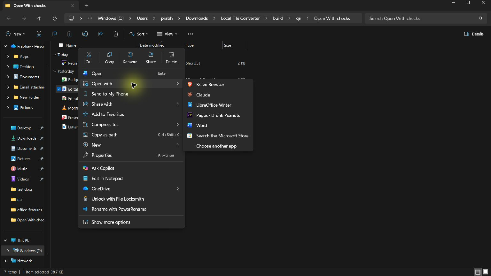
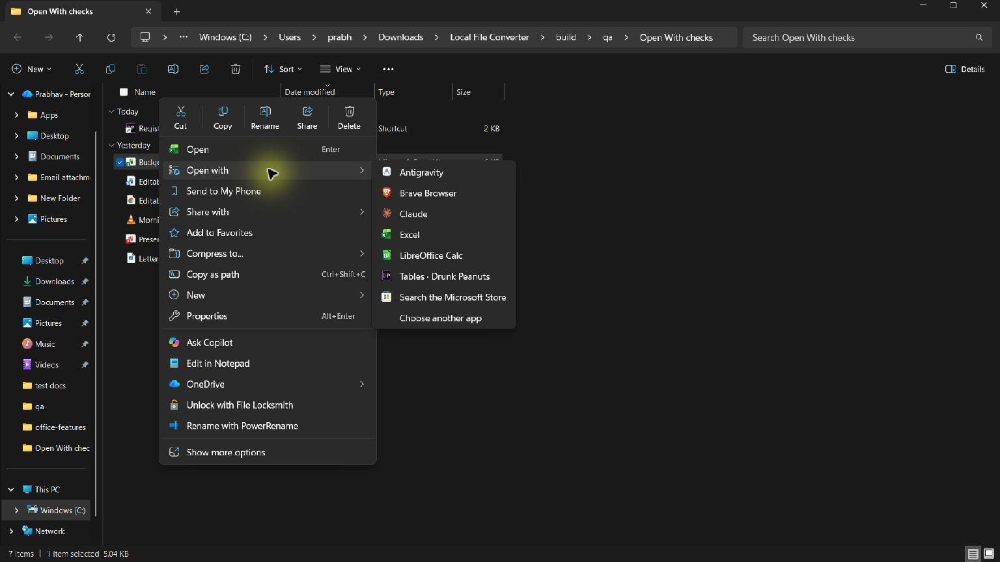
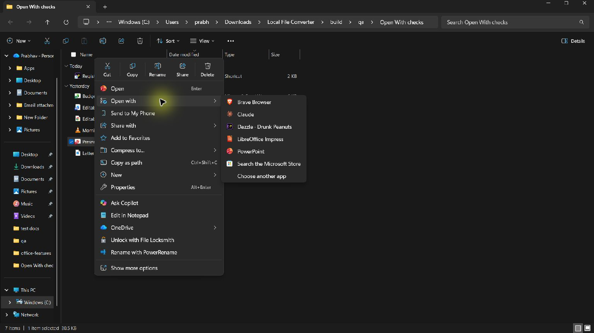
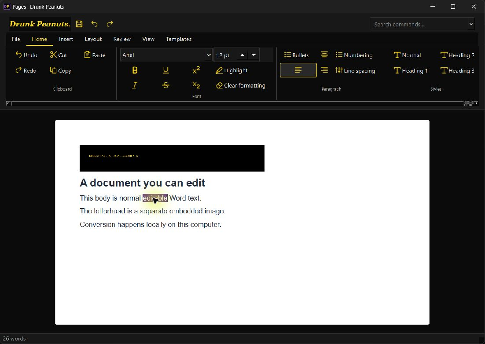
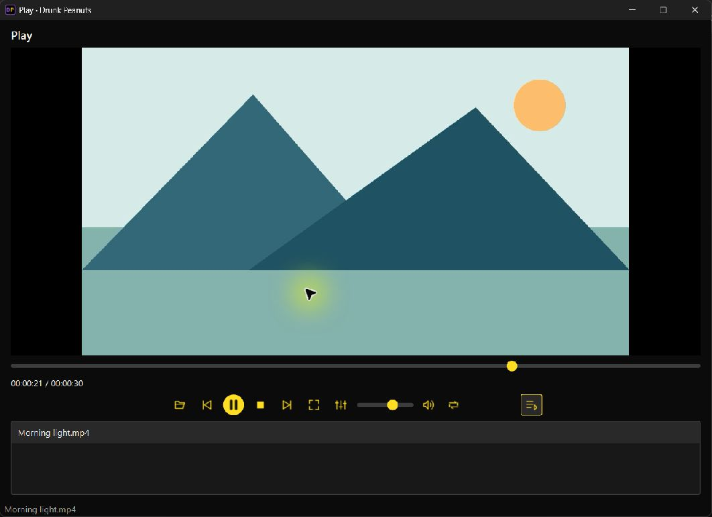
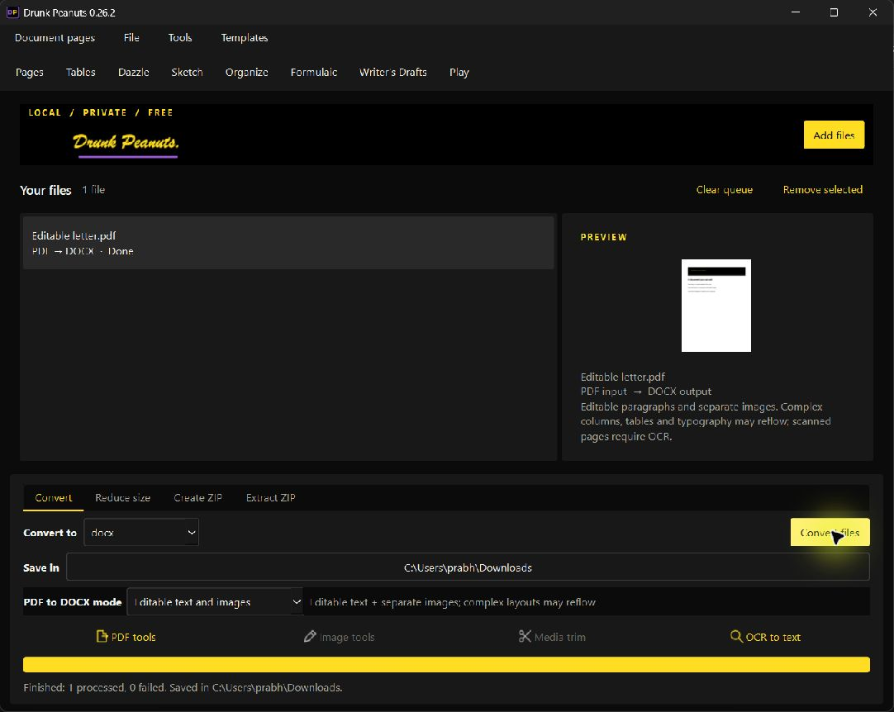

# Editable PDF and Windows Open with — 0.26.2

PDF → DOCX now defaults to **Editable text and images**. Selectable PDF text becomes normal Word paragraphs; embedded raster pictures become independently positioned Word images. This uses the bundled PDFium engine and works offline without installing Word. The reported private letter was checked locally: editable body text, separate letterhead/signature images, and a one-page LibreOffice rendering. The original was left untouched; private content is excluded from this repository.

This is a single-column reconstruction, not full PDF layout recovery. Font substitutions, line breaks, complex tables/columns and vector artwork can differ. Rotated pages must be prepared first. Image-only/scanned pages report that OCR is required rather than silently returning an image-only DOCX. **Preserve pages (not editable)** retains complete rendered pages; **Text only** omits images.

## Windows file integration

Setup includes eight small Windows launchers: Pages, Tables, Dazzle, Sketch, Organize, Formulaic, Writer and Play. Windows can identify each app separately rather than treating every workspace as the same generic executable. Launchers forward quoted file paths to the installed main executable. Office files open directly in their workspace; multiple documents open in separate windows, preserving existing work.

| App | Registered formats |
| --- | --- |
| Pages | DOCX, TXT, HTML, HTM |
| Tables | XLSX, CSV |
| Dazzle | PPTX, DAZZLE |
| Sketch | PNG, JPG, JPEG, BMP |
| Organize | SQLITE, DB |
| Formulaic | FORMULAIC, MML |
| Writer | FOUNTAIN, FDX |
| Play | MP4, MKV, MOV, AVI, WEBM, MPEG, MPG, WMV, M4V, MP3, WAV, FLAC, OGG, M4A, AAC, AIFF, WMA |

Registration uses per-user ProgIDs, Applications/SupportedTypes and RegisteredApplications capabilities. It never changes UserChoice, extension defaults or another application's registration. Setup registers automatically; the Start-menu repair shortcut repeats registration through normal Windows app activation. a portable Windows download needs its complete extracted folder and a one-time `LocalFileConverter.exe --register-windows`. Uninstall removes matching owned values only. An older installation cannot unregister a newer installation.

Explorer chooses its short Open with list; **Choose another app** exposes additional candidates. Close and reopen an already open menu after installation. The desktop shortcut opens the main suite as before.

Microsoft references: [Open with registration](https://learn.microsoft.com/en-us/windows/win32/shell/how-to-include-an-application-on-the-open-with-dialog-box) and [application registration](https://learn.microsoft.com/en-us/windows/win32/shell/default-programs).

## Validation

- 89 source tests passed locally. Windows, Intel macOS and Apple Silicon CI passed on commit `ec38ded` ([run 40448573166](https://github.com/Thatweirdguy1/Drunk-Peanuts/actions/runs/40448573166)).
- The downloaded Windows installer and portable ZIP match the release SHA-256 manifest and GitHub asset digests. The installed main executable and all eight launchers match the CI portable package byte for byte.
- Installed workspace imports, playback-engine initialization, native document round trip and editable PDF conversion passed. A real conversion through the installed UI also produced an editable DOCX with its separate image. The private sample retains all selectable non-whitespace text in order, nine embedded image files and eleven positioned pictures; the original PDF hash is unchanged. Its editable copy remains local.
- All 35 recorded default-app choices remained unchanged after installation.
- Actual Windows 11 Explorer menus were checked for **MP4 → Play, DOCX → Pages, XLSX → Tables and PPTX → Dazzle**. Files opened in the matching app; Play rendered video frames and Pages exposed selectable editable text. Version 0.26.2 hides the legacy media candidate, leaving one Play entry.
- During validation, registration from the build-tool context did not update the visible Explorer menu, despite successful registry/API checks. Running the installed registration action through normal Explorer activation made the handlers visible. This is an observed difference between those launch paths; the underlying Windows context behavior was not fully traced. The installer now adds **Start → Drunk Peanuts → Repair Open with registration** as a terminal-free recovery action. Launch it normally from Windows if an old installation's menus remain missing.
- No personal document content is included in this repository or release screenshots. Screenshots use synthetic documents and video.

