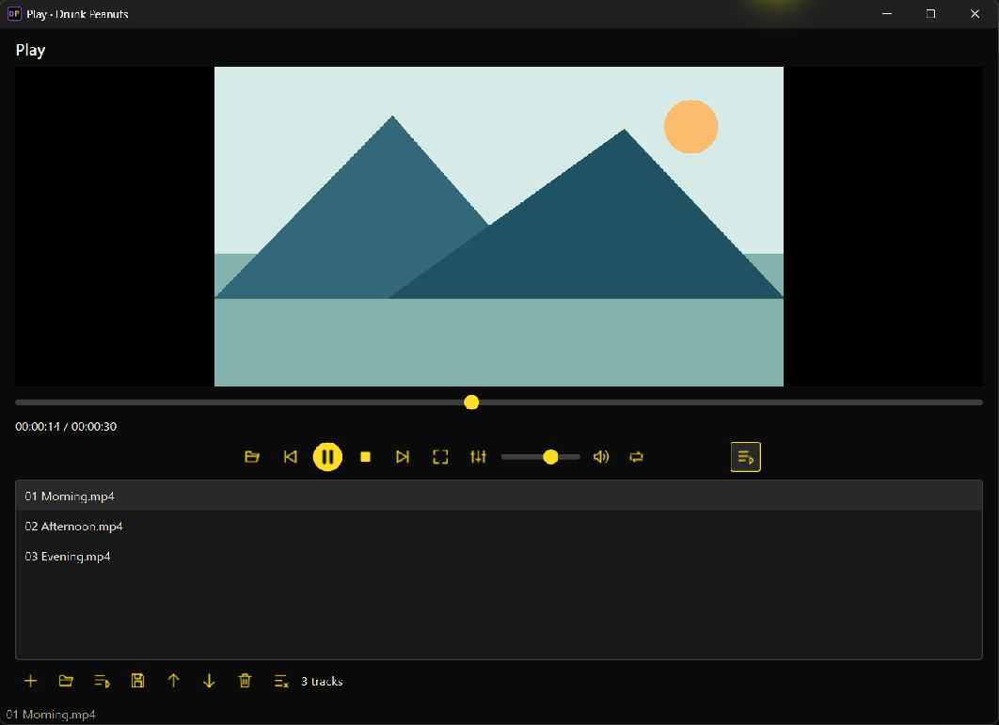
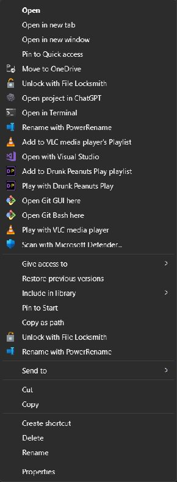

# Play folders and playlists — 0.27.1

Windows folders gain two per-user context-menu actions under **Show more options**:

- **Play with Drunk Peanuts Play** adds supported local media recursively and starts the first newly added track.
- **Add to Drunk Peanuts Play playlist** appends to the existing Play queue without changing the playing track. If Play is closed it opens with an idle queue; press Play to begin.

The actions do not change file defaults or VLC's existing commands. Setup installs them; the existing **Repair Open with registration** Start-menu action refreshes them. Uninstall removes only this installation's owned values.

Use the playlist toggle in Play to show the queue and its compact toolbar. It supports adding files/folders, opening and saving UTF-8 M3U/M3U8 files, drag reordering, move up/down, removing selected tracks and clearing. These actions affect playlist entries, never the media files. Removing the currently playing entry stops it; removing or moving other entries preserves playback. Reordering the playing entry updates its queue position without restarting it. Existing next/previous, automatic advance and single-track repeat work with the edited order.

Folder scanning runs in a cancellable worker; enqueue requests received during startup are retained in order. A same-user Qt local socket delivers Explorer requests to the existing Play window. The sender exits only after acknowledgment. No server, account or network connection is required.

Saved playlists contain local file URLs, including spaces, Unicode and `#` characters. Relative paths and local file URLs can be imported. Unsupported/missing media are skipped. Remote URLs and VLC directives are not executed. Nested playlists are cycle checked and limited to 20 levels; individual playlist files are limited to 1 MB. Folder symlinks are skipped to avoid recursive loops. Moving source media can break saved references. M3U/M3U8 are supported; XSPF/PLS, streaming playlists, automatic queue recovery and cloud libraries are outside this batch.

## VLC investigation

The installed Windows VLC folder registration uses separate `--playlist-enqueue` and `--no-playlist-enqueue` commands with quoted `%1` arguments and `MultiSelectModel=Player`. This is direct registration evidence, not inferred binary behavior.

REA with Ghidra 12.1.4 found `libvlc_playlist_play` in the installed x64 `vlc.exe` string inventory. REA's Rizin probe independently found that import at `0x1400ea638`; SHA-256 was unchanged before/after: `63d0d02df6e466d642b824dc66be6b5a134bf98b26747ffac8ec0d879dc180d7`. These are static observations; they do not prove the implementation of every VLC playlist feature. Drunk Peanuts reuses its existing libVLC media player and implements its own editable local queue. Android tools JADX, Apktool and ADB do not apply to this Windows PE executable.

## Checks

`python -m unittest test_play_queue test_watchit test_windows_integration -q` covers folder expansion, Unicode/file-URL playlist round trips, nested-cycle/remote-directive rejection, enqueue preservation, reorder/remove/clear behavior, quoted folder registration and cross-process enqueue acknowledgment.

93 source tests passed. The [0.27.1 build](https://github.com/Thatweirdguy1/Drunk-Peanuts/actions/runs/40569989211) passed on Windows x64, Intel macOS and Apple Silicon, including packaged playlist, playback-engine, OCR and native conversion checks. The packaged playlist check resolves temporary paths before comparing them, including macOS `/var` aliases.

The Windows installer and portable ZIP matched the release checksums and GitHub asset digests. Installed version 0.27.1 and all eight launchers matched the CI portable package. Installed suite and native-conversion checks passed. All 37 checked default-app choices were unchanged.

Actual Explorer checks verified both folder actions with synthetic media. Enqueue opened an idle two-track queue; Play with reused that window and started playback. A subsequent enqueue preserved the paused track. A separate folder with three tracks, including a subfolder, played successfully. Saving through the installed playlist toolbar produced a valid M3U8 that reopened all three local references in order. On this upgraded installation, the existing registration repair shortcut was needed after Setup before Explorer displayed the new actions.

