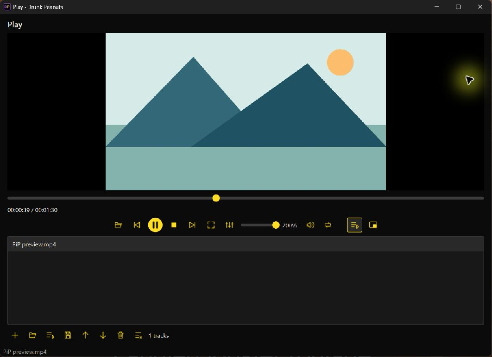
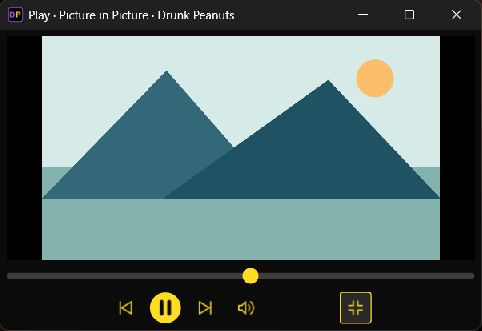

# Play: Picture in Picture and 200% volume — 0.28.1

The volume slider spans 0–200%, starts at 100%, displays its current percentage and keeps mute separate. Boost above 100% uses libVLC's native volume control; it does not rewrite the media or change the Windows system-volume setting. Loud source material can distort when boosted. The selected gain is reapplied after the audio output starts, since VLC can reset a volume request made during startup.

Click **Picture in Picture** or press **Ctrl+Shift+P** to enter a compact 480×300, resizable, always-on-top window. Its native title bar supports moving/resizing. Previous/next, play/pause, mute, seek and the restore button remain available. Other controls are restored when leaving PiP, including the previous playlist visibility, window geometry/maximized state and window flags. **Escape** or the restore icon exits PiP. Closing the PiP window closes Play; use restore to return to the full interface.

PiP reuses the same libVLC player and native video surface. It does not restart playback, create a second audio stream or replace the queue. Entering PiP from fullscreen first restores the normal window. Fullscreen requested from PiP exits PiP before entering fullscreen.

This is a native desktop mini-player. It is not browser PiP, does not float above exclusive fullscreen games or secure system screens, and does not provide operating-system media overlays or persistent PiP placement.

## VLC investigation

REA/Rizin inspected the installed Windows `libvlc.dll` and found `libvlc_audio_set_volume` at `0x14000abb0`. REA/Ghidra 12.1.4 analyzed the function: the assembly converts the integer percentage to floating point, scales by 0.01 and calls `aout_VolumeSet`; it rejects negative values or an unavailable audio output. Decompiler signatures are inferred, so the assembly was used to interpret the integer argument. SHA-256 remained `c0b1bedbc8e11267b39111733920a6af73d08791e333e4f8902eaffe4daf6db9` before/after inspection.

A native runtime probe with a silent WAV reported volume 200 after audio initialization on the installed Windows mmdevice, DirectSound and waveOut backends. The same silent fixture through Play's actual startup/refresh path reported `State.Playing`, native volume 200 and UI label `200%` after startup. The dummy output does not report gain, so it was not used to claim audible-output validation. No audible test tone or system-volume changes were required.

These observations cover native volume control, not every VLC feature. PiP window management is implemented with Qt's native `QWindow` topmost hint, preserving both the window and video-surface handles. Android tools JADX, Apktool and ADB do not apply to these Windows PE libraries.

## Automated checks

`python -m unittest test_watchit test_ui_regressions test_play_queue -q` checks the 200% bound/readout, PiP controls and sizing, topmost hint, stable window/surface handles, unchanged player/queue, geometry/maximized-state restoration and fullscreen transitions. The packaged `--playlist-self-check` also checks the 200% control and PiP handle/flag round trip on all release platforms.

94 source tests passed. The [0.28.1 build](https://github.com/Thatweirdguy1/Drunk-Peanuts/actions/runs/40575973703) passed for Windows x64, Intel macOS and Apple Silicon, including packaged PiP/volume, playlist, OCR, playback-engine and native-conversion checks. Incoming media is also covered: enqueueing while PiP is active preserves the compact view and the previous playlist visibility.

The Windows installer and portable ZIP matched their published checksums and GitHub digests. Installed version 0.28.1 and all eight launchers matched the CI portable package; installed suite and native-conversion checks passed.

Computer control was reserved for the final installed visual check with a synthetic video and silent audio. The UI accepted 200%, Ctrl+Shift+P displayed decoded video in the compact window, and Escape restored the full layout, queue and 200% value. Playback advanced through the switch instead of restarting. The test window was then closed. No unrelated apps were controlled.

